<!--
  Profile README for github.com/Suvraneel. Art is built from the portfolio's own
  type, texture and colours; see scripts/README.md.
-->

  
  
  
  
  
   
  Also on <a href="https://www.linkedin.com/in/suvraneel-bhuin/">LinkedIn</a> · <a href="https://twitter.com/SuvraneelB">X</a> · <a href="https://www.codechef.com/users/suvraneel">CodeChef</a> · <a href="https://www.hackerrank.com/bsuvraneel">HackerRank</a> · <a href="https://www.freecodecamp.org/suvraneel">freeCodeCamp</a> · <a href="https://auth.geeksforgeeks.org/user/bsuvraneel/">GeeksforGeeks</a> · <a href="https://suvraneel.bio.link/">more</a>

<a href="https://suvraneel.github.io/about">
  <picture>
    <source media="(prefers-color-scheme: light)" srcset="assets/brand/h-about-light.svg">
    
  </picture>
</a>

**I like building things that are useful, not just impressive.**

<table>
  <tr>
    <td width="150"><b>Now</b></td>
    <td>Advanced App Engineering Sr. Analyst, <b>Accenture</b> · 2023 – present</td>
  </tr>
  <tr>
    <td><b>Focus</b></td>
    <td>Backend services, integrations and APIs · agentic workflows with MCP · product interfaces</td>
  </tr>
  <tr>
    <td><b>Core stack</b></td>
    <td>Java · Spring Boot · Node.js · TypeScript · FastAPI · PostgreSQL · Redis · Elasticsearch</td>
  </tr>
  <tr>
    <td><b>Education</b></td>
    <td>B.Tech, Computer Science &amp; Engineering, University of Calcutta (UCSTA) · 2019 – 2023 · 9.24 CGPA</td>
  </tr>
  <tr>
    <td><b>Community</b></td>
    <td>Organiser, Web3Conf India 2023 · Technical Program Manager, GirlScript Summer of Code 2022</td>
  </tr>
  <tr>
    <td><b>Recognition</b></td>
    <td>Hackathon wins with team <a href="https://github.com/Open-Sorcerer">Open Sorcerer</a>, including ETHGlobal Circuit Breaker '24 and Chainlink Fall · IPFS/Filecoin microgrant for StakeOverflow</td>
  </tr>
</table>

<a href="https://suvraneel.github.io/skills">
  <picture>
    <source media="(prefers-color-scheme: light)" srcset="assets/brand/h-skills-light.svg">
    
  </picture>
</a>

<a href="https://github.com/Suvraneel?tab=repositories">
  <picture>
    <source media="(prefers-color-scheme: light)" srcset="assets/brand/h-github-light.svg">
    
  </picture>
</a>


  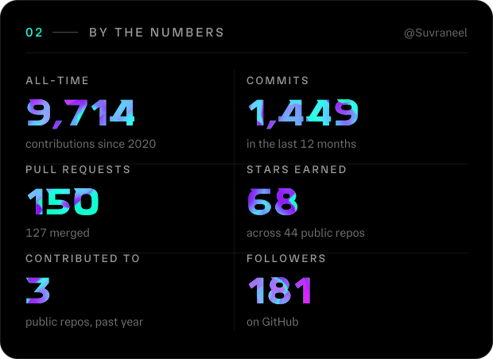
  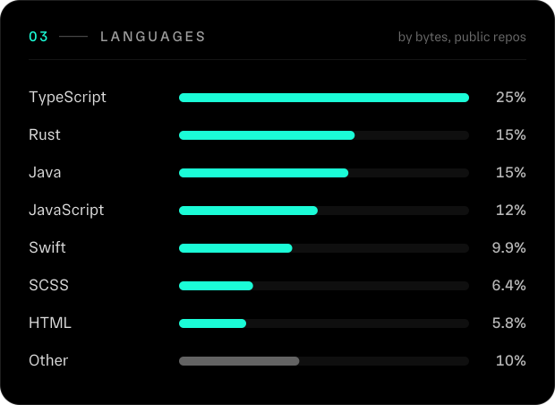

<a href="https://leetcode.com/u/Suvraneel/">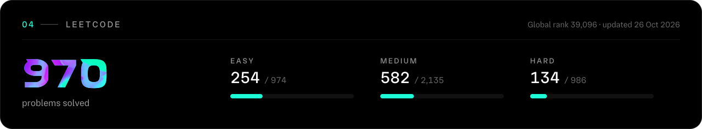</a>

<!--START_SECTION:activity-->
| | Activity | Repository | When |
| :-: | :-- | :-- | --: |
|  | Pushed to `main` | [Suvraneel/Radlet](https://github.com/Suvraneel/Radlet) | 28 Oct |
|  | Pushed 15 commits to `main` | [Suvraneel/Suvraneel.github.io](https://github.com/Suvraneel/Suvraneel.github.io) | 28 Oct |
|  | Merged PR [#5 Install prompts for installing additional dependencies at runti…](https://github.com/Suvraneel/Radlet/pull/5) | [Suvraneel/Radlet](https://github.com/Suvraneel/Radlet) | 28 Oct |
|  | Opened PR [#5 Install prompts for installing additional dependencies at runti…](https://github.com/Suvraneel/Radlet/pull/5) | [Suvraneel/Radlet](https://github.com/Suvraneel/Radlet) | 28 Oct |
|  | Merged PR [#34 About depth qa fixes](https://github.com/Suvraneel/Suvraneel.github.io/pull/34) | [Suvraneel/Suvraneel.github.io](https://github.com/Suvraneel/Suvraneel.github.io) | 28 Oct |
<!--END_SECTION:activity-->

  
<b>More from GitHub</b> · isometric calendar and community

   
  
  

<a href="https://suvraneel.github.io/projects">
  <picture>
    <source media="(prefers-color-scheme: light)" srcset="assets/brand/h-projects-light.svg">
    
  </picture>
</a>

<table>
  <tr>
    <td width="50%" valign="top">
      <a href="https://usemonoma.com">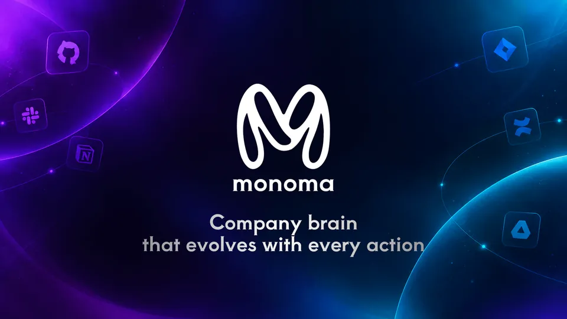</a>
      <h3>Monoma</h3>
      
Multi-tenant agentic AI platform that turns Jira, Confluence, GitHub and Slack activity into a shared organisational graph, with 18+ permission-aware MCP tools.

      
FASTAPI · CELERY · POSTGRESQL · PGVECTOR · REDIS · MCP

      <a href="https://usemonoma.com">Visit project ↗</a> &nbsp;·&nbsp; <a href="https://www.youtube.com/watch?v=1yD7N6u9MG8">Watch demo ↗</a>
    </td>
    <td width="50%" valign="top">
      <a href="https://settlex.fi">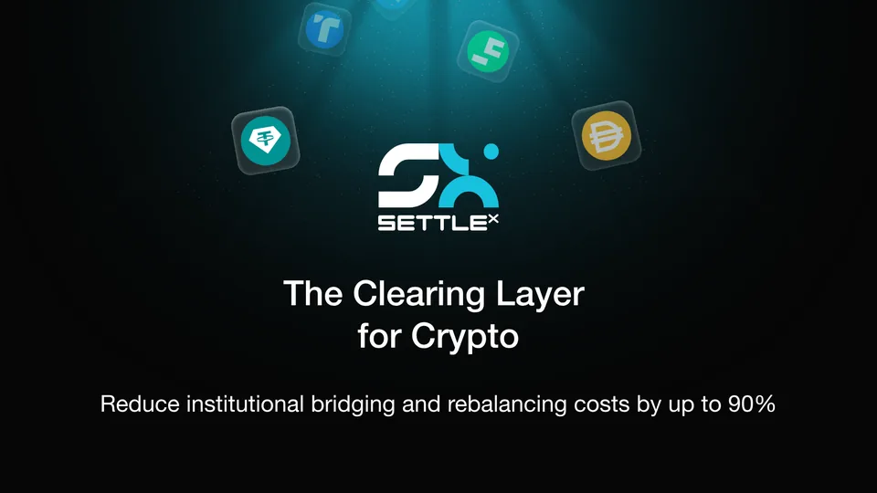</a>
      <h3>SettleX</h3>
      
Chain-agnostic settlement protocol that nets cross-chain transfers instead of bridging each one, cutting fees by up to 90%.

      
BUN · ELYSIA · AWS · POSTGRESQL · WEBSOCKETS · NEXT.JS

      <a href="https://settlex.fi">Visit project ↗</a> &nbsp;·&nbsp; <a href="https://www.youtube.com/watch?v=2CyxdCe9RD8">Watch demo ↗</a>
    </td>
  </tr>
  <tr>
    <td width="50%" valign="top">
      <a href="https://stake-overflow.vercel.app/">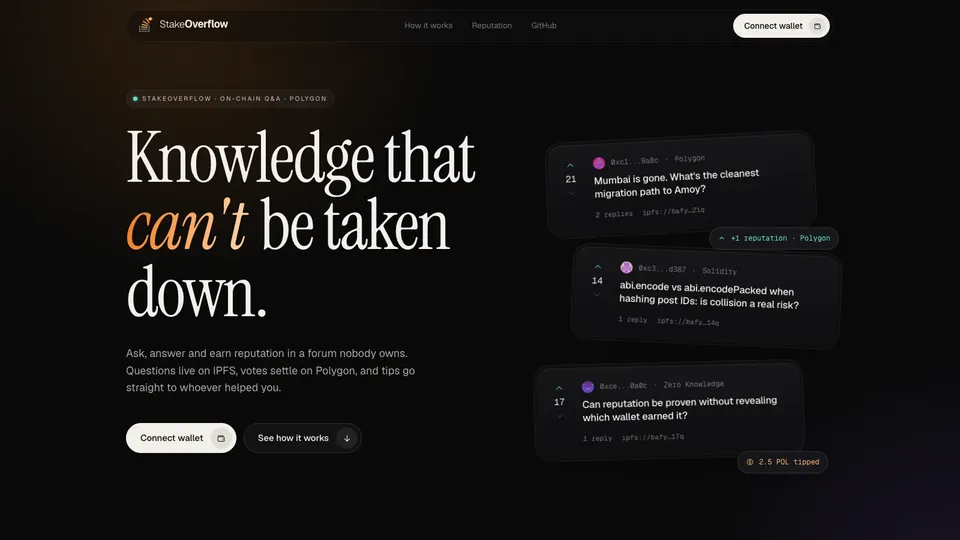</a>
      <h3>StakeOverflow</h3>
      
Stack Overflow on IPFS and Polygon, with karma-based reputation and crypto tips; funded by an IPFS/Filecoin microgrant.

      
IPFS · REACT · ANT DESIGN · SOLIDITY · POLYGON

      <a href="https://stake-overflow.vercel.app/">Visit project ↗</a> &nbsp;·&nbsp; <a href="https://github.com/Open-Sorcerer/StakeOverflow">View source ↗</a>
    </td>
    <td width="50%" valign="top">
      <a href="https://gssoc-2022.vercel.app/">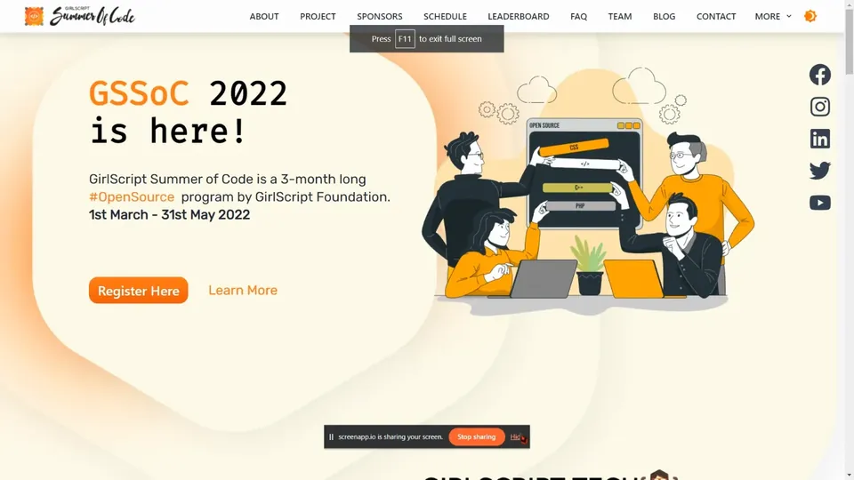</a>
      <h3>GSSoC 2022 Official Website</h3>
      
Official site of a national open-source programme, with a live leaderboard and on-chain certificates; 6,000+ contributors registered through it.

      
NEXT.JS · TAILWIND CSS · CHAKRA UI · FIGMA · SOLIDITY

      <a href="https://gssoc-2022.vercel.app/">Visit snapshot ↗</a> &nbsp;·&nbsp; <a href="https://github.com/Suvraneel/gssoc-website-new">View source ↗</a>
    </td>
  </tr>
</table>

  
<b>More projects</b> · NFTs, DAOs, games, ML and the odd music player

   

| Project | What it is | Built with | Links |
| :-- | :-- | :-- | :-- |
| **NFT Haven** | Multi-chain DeFi dashboard and soulbound NFT minter on Polygon | React, Web3.js, Solidity, Moralis, Chainlink | [Live](https://nft-haven.vercel.app/) · [Code](https://github.com/Suvraneel/Instant-Soulbound-NFT-Minter) |
| **EthCommerce** | Creators sell directly to their audience across chains, with data on IPFS and QuickNode alerts | Next.js 13, Solidity, IPFS, thirdweb, Hardhat, wagmi | [Live](https://ethcommerce.vercel.app/) · [Code](https://github.com/Open-Sorcerer/EthCommerce) |
| **CrewS** | No-code tool for Data DAOs on FVM: proposals, on-chain voting and execution | Next.js, Solidity, FVM, IPFS | [Code](https://github.com/Open-Sorcerer/CrewS) |
| **SoLingo** | Learn-to-earn: Solana Cookbook quizzes that award NFTs per module | Anchor, TypeScript, React, Solana | [Code](https://github.com/Open-Sorcerer/SoLingo) |
| **Bounty Gunslinger** | NFT-gated game access you can trade on when you're done playing | React, Polygon, Solidity, Phaser | [Live](https://open-sorcerer-nft-game-token.vercel.app/) · [Code](https://github.com/Suvraneel/Bounty-Gunslinger) |
| **JailBreak** | A 2D RPG built from scratch in stock Java, no engine or JavaFX | Java 17, OOP, sprites, threads | [Code](https://github.com/Suvraneel/JavaMonsterz) |
| **CoWIN Clone** | MERN clone of cowin.gov.in with an API for beneficiaries, centres and slots | React, Redux, Express, MongoDB, Node.js | [Live](https://cowin-clone-ui.vercel.app/) · [Code](https://github.com/Suvraneel/cowin-clone-ui) |
| **Meteorologyly** | Minimal weather dashboard: current conditions, forecasts and charts for any city | JavaScript, Chart.js, weather APIs | [Live](https://suvraneel.github.io/Meteorologyly/) · [Code](https://github.com/Suvraneel/Meteorologyly) |
| **Stock trend prediction** | Short-term price trends for NSE equities with a 4-layer LSTM | Python, TensorFlow, Keras, BeautifulSoup | — |
| **Diablo Music** | A dark, minimal music player for the nocturnal, local and online | Flutter, Dart, Firebase | [Code](https://github.com/Suvraneel/Diablo-Music) |

<a href="https://suvraneel.github.io/work">
  <picture>
    <source media="(prefers-color-scheme: light)" srcset="assets/brand/h-work-light.svg">
    
  </picture>
</a>

### Advanced App Engineering Sr. Analyst · Accenture
2023 – PRESENT

- **Java Spring Boot microservices** for a BI portal serving a global media client
- **60% fewer support tickets** through better data validation and error handling
- **30% faster Elasticsearch queries**

#### Community & leadership

| When | Role | What I did |
| :-- | :-- | :-- |
| Jun – Aug 2023 | **Organiser · Core Team** Web3Conf India 2023 | Coordinated speakers, sponsors and media partners; helped convene 2,500+ attendees, 100+ speakers and 150+ companies and sponsors. |
| Jan – Apr 2023 | **Program Manager** HyperEdge Winter of Blockchain 2023 | Ran a blockchain learning programme for an 800+ member community; hosted 10+ sessions and workshops. |
| Jan – Aug 2022 | **Technical Program Manager** GirlScript Summer of Code 2022 | Led a 30-person team and the contributor workflow; built the official Next.js site for 6,000+ contributors; secured 10+ partnerships and $10k+ in sponsorship. |
| Nov 2021 – Feb 2022 | **Full-stack Web Development Intern** GEOGO TechSolutions | Built MERN apps and documented APIs, including a CoWIN vaccination-booking clone. |
| Sep – Dec 2021 | **Supervisor & Mentor · C/C++** GirlScript Winter of Contributing 2021 | Reviewed contributions to a ~900★ / 1.6k-fork repository; mentored 6,000+ participants; built GitHub Actions automation. |
| Mar – Jun 2021 | **Open-source Contributor** GirlScript Summer of Code 2021 | 14 merged pull requests across NeoAlgo and AlgoTree; top 100 of 7,000+ participants. |

 

  

<a href="https://suvraneel.github.io">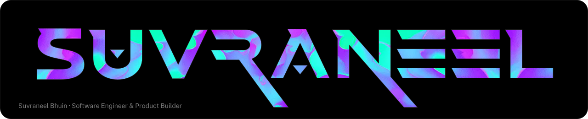</a>

  

